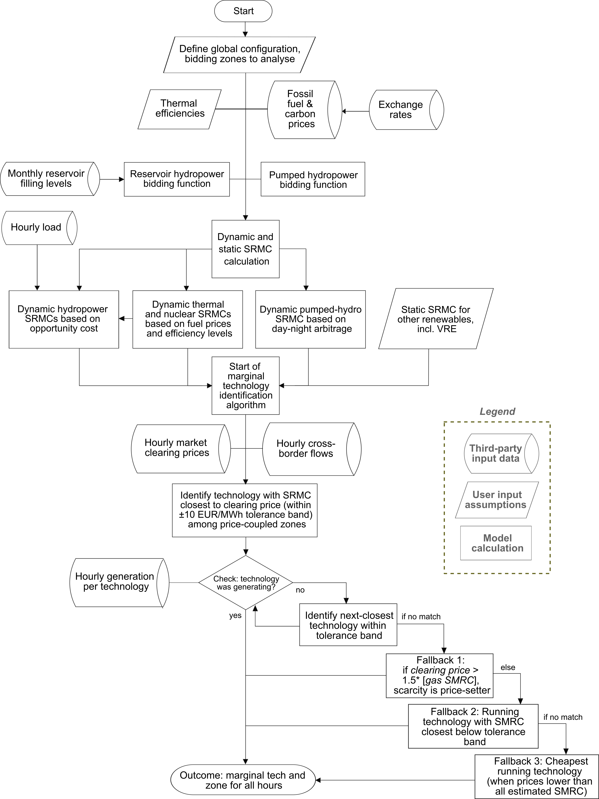

# Price-setting technologies in EU electricity markets
---

## Introduction

This repository contains the code behind the manuscript "Price-setting tipping points in decarbonising EU electricity markets" (in preparation), an open source framework for reverse-engineering price-setting technologies based on observed generation, cross-border flows, wholesale prices, and commodity costs. 

This framework is used to assess a decade of hourly data across EU bidding zones and capture technological marginality across the full generation spectrum, from variable renewables (VRE, i.e. solar and wind power) and hydropower to nuclear and fossil-powered units. 

The gained empirical insights can inform energy policy across multiple domains: clarifying the coupling of electricity prices and fossil fuel costs, quantifying the effect of increased VRE generation in displacing fossil fuel price-setters, and illustrating how interconnections affect price-setting.

## Diagram
Below, a schematic diagram of the logic of the price-setting identifying algorithm is displayed.

# 

## Installation

This price-setting framework comprises one executable Python script, under the control of an Excel-based "control file" and two more Excel files to support the process of the user's commodity and price, generation, flows, loads and reservoir level data.
The repository contains the following files:

* _Price_setting_publishable.py_ (the actual code)
* _control_file.xlsx_ (the control file, providing crucial input parameters to the code)
* _user_commodity_file.xlsx_ (providing commodity time series to the code)
* _example_inputs.xlsx_ (providing generation and flow time series to the code; optional)

The most recent version of the algorithm was written for Python 3.9.

The [envs](https://github.com/imartinezn/price-setting/tree/master/envs) folder contains a .yml configuration file to install the needed packages to run the code.

## License
See also the [LICENSE](./LICENSE.md) file.

## Authors

Ignacio Martínez, Directorate-General for Energy, European Commission, ignacio.martinez1@ec.europa.eu

Derck Koolen, Directorate-General for Energy, European Commission & School of Economics, Utrecht University, derck.koolen@ec.europa.eu

Massimo Tognoni, Directorate-General for Energy, European Commission, massimo.tognoni@ec.europa.eu

Sebastian Sterl, Directorate-General for Energy, European Commission & Faculty of Engineering, Vrije Universiteit Brussel (VUB), sebastian.sterl@vub.be
